

  

📜 Reza a lenda que em **2016** um jovem aprendiz conjurou seu primeiro `"Hello, World"`.
Desde então invoca APIs, ergue arquiteturas e bane bugs da produção.
Nas horas vagas explora masmorras (jogos), estuda grimórios novos
e mantém seu castelo em **Arch Linux**, btw.

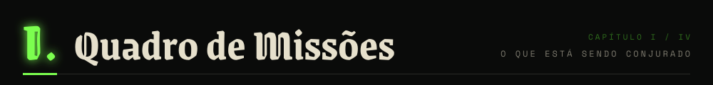

  
  
   
  <a href="https://github.com/vinbeze/mercado-ingestao"></a>
  <a href="https://github.com/vinbeze/gerador-exercicios"></a>
   
  <a href="https://github.com/vinbeze/node-typescript-api"></a>
  <a href="https://github.com/vinbeze/spring-boot-ionic-backend"></a>

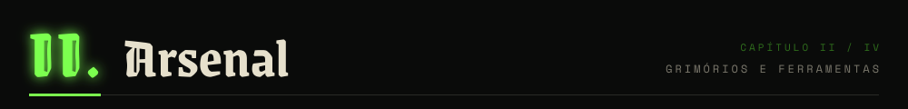

  

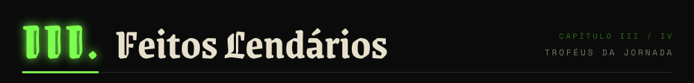

  

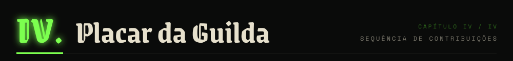

  

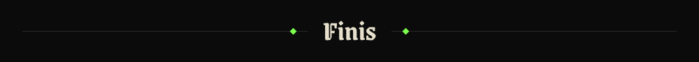
