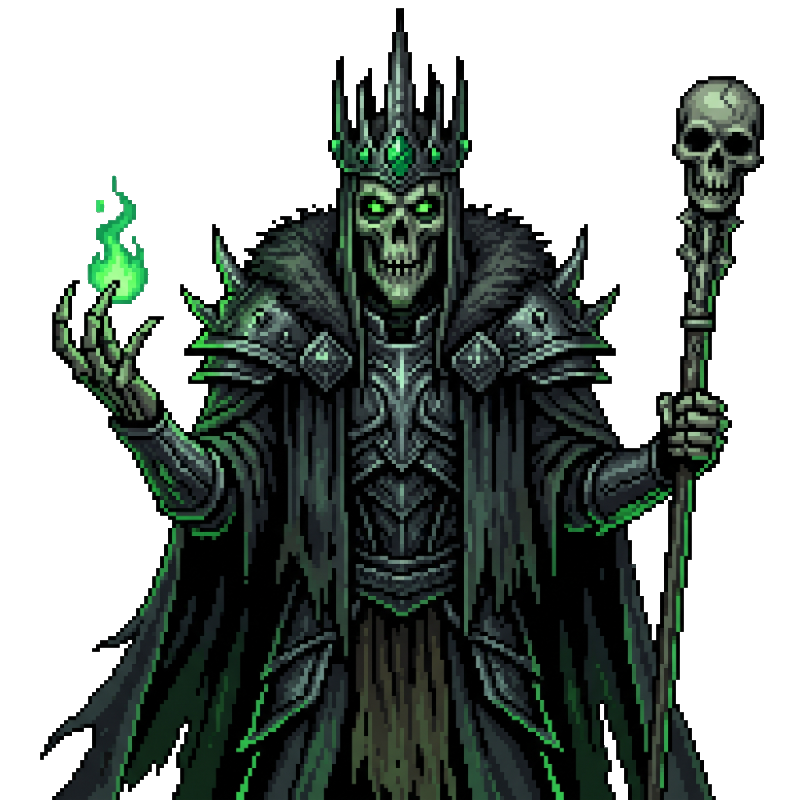
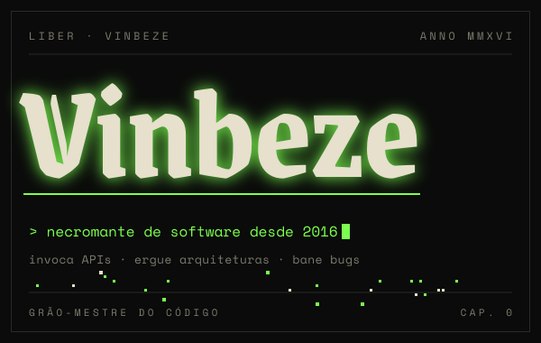

  
  

📜 Reza a lenda que em **2016** um jovem aprendiz conjurou seu primeiro `"Hello, World"`.
Desde então invoca APIs, ergue arquiteturas e bane bugs da produção.
Nas horas vagas explora masmorras (jogos), estuda grimórios novos
e mantém seu castelo em **Arch Linux**, btw.

 

| Missão | Grupo | Situação |
|:--|:--|:--|
| **PDV para mercados** frente de caixa com estoque, NFC-e e modo quiosque no Ubuntu | `Go` `React` `Wails` `PostgreSQL` | ● em andamento |
| **Masmorras de game dev** protótipos e engines nas horas vagas | `C++` `Rust` | ◌ explorando |
| **mercado-ingestao** ingestão de dados de mercado | `Python` | ✓ concluída |
| **gerador-exercicios** gerador de exercícios | `Python` | ✓ concluída |
| **node-typescript-api** API em Node com TypeScript | `Node.js` `TypeScript` | ✓ concluída |
| **spring-boot-ionic-backend** back-end REST | `Java` `Spring Boot` | ✓ concluída |

  

| Feito | Como foi conquistado |
|:--|:--|
| **O Primeiro Feitiço** | primeiro commit no GitHub — 2016 |
| **Mestre dos Grimórios** | projetos em Java, C#, Go, Python, TypeScript, Rust e C++ |
| **Guardião do Arch** | Arch Linux como sistema principal, btw |
| **Construtor de Fortalezas** | PDV rodando em modo quiosque, do banco ao boot |
| **Rolou 20 natural** | nunca largou o controle |

  

