<p align="center">
  
</p>

<p align="center">
  
</p>

```txt
> CARREGANDO SAVE... OK
> Olá! Sou o Vinicius, dev back-end desde 2016.
> De dia: APIs, arquitetura e sistemas que não caem em produção.
> De noite: jogos, Linux (Arch, btw) e projetos que começam com "e se eu fizesse...".
```

### ▸ QUEST LOG

| | Quest | Party (stack) | Status |
|:-:|---|---|:-:|
| 🗡️ | **PDV para mercados** — frente de caixa com estoque, NFC-e e modo quiosque no Ubuntu | `Go` `React` `Wails` `PostgreSQL` | 🟢 em andamento |
| 🎮 | **Side quests de game dev** — protótipos e engines nas horas vagas | `C++` `Rust` | 🟡 explorando |
| 📦 | [**mercado-ingestao**](https://github.com/vinbeze/mercado-ingestao) — ingestão de dados de mercado | `Python` | ✅ |
| 🧪 | [**gerador-exercicios**](https://github.com/vinbeze/gerador-exercicios) — gerador de exercícios | `Python` | ✅ |
| 🧱 | [**node-typescript-api**](https://github.com/vinbeze/node-typescript-api) — API em Node com TypeScript | `Node.js` `TypeScript` | ✅ |
| ☕ | [**spring-boot-ionic-backend**](https://github.com/vinbeze/spring-boot-ionic-backend) — back-end REST | `Java` `Spring Boot` | ✅ |

### ▸ INVENTÁRIO

<p align="center">
  
</p>

<details>
<summary><b>CONQUISTAS DESBLOQUEADAS</b> — clique para abrir 🏆</summary>
<br>

| | Conquista | Como desbloquear |
|:-:|---|---|
| 🏁 | **Hello, World** | Primeiro commit no GitHub — 2016 |
| 🧙 | **Poliglota** | Projetos em Java, C#, Go, Python, TypeScript, Rust e C++ |
| 🐧 | **I use Arch, btw** | Arch Linux como sistema principal |
| 🚀 | **Shipped!** | Colocar um PDV para rodar em modo quiosque numa loja de verdade |
| 🕹️ | **Player 1** | Nunca ter largado o controle |

</details>

### ▸ HIGH SCORE

<p align="center">
  
</p>

<p align="center">
  <a href="https://github.com/vinbeze?tab=followers">
    
  </a>
</p>
