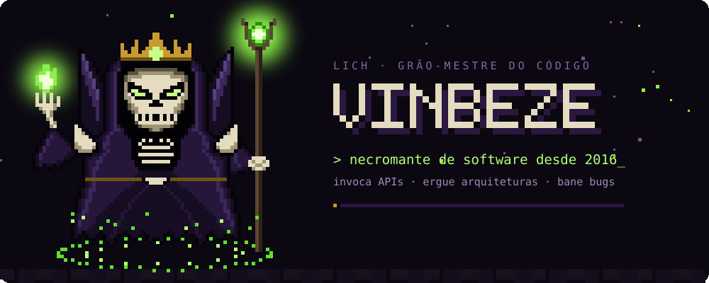
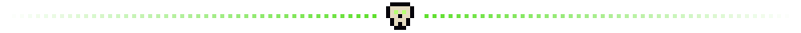

  

> 📜 Reza a lenda que em **2016** um jovem aprendiz conjurou seu primeiro `"Hello, World"`.
> Desde então invoca APIs, ergue arquiteturas e bane bugs da produção.
> Nas horas vagas explora masmorras (jogos), estuda grimórios novos
> e mantém seu castelo em **Arch Linux**, btw.

## ⚔️ QUADRO DE MISSÕES

| | Missão | Grupo (stack) | Situação |
|:-:|:--|:--|:-:|
| 🏰 | **PDV para mercados** — frente de caixa com estoque, NFC-e e modo quiosque no Ubuntu | `Go` `React` `Wails` `PostgreSQL` | 🔥 em andamento |
| 🐉 | **Masmorras de game dev** — protótipos e engines nas horas vagas | `C++` `Rust` | 🗺️ explorando |
| 📦 | **mercado-ingestao** — ingestão de dados de mercado | `Python` | ✅ concluída |
| 🧪 | **gerador-exercicios** — gerador de exercícios | `Python` | ✅ concluída |
| 🧱 | **node-typescript-api** — API em Node com TypeScript | `Node.js` `TypeScript` | ✅ concluída |
| ☕ | **spring-boot-ionic-backend** — back-end REST | `Java` `Spring Boot` | ✅ concluída |

## 🎒 ARSENAL

  

<b>🏆 FEITOS LENDÁRIOS</b> — clique para abrir o pergaminho

 

  

## 📈 PLACAR DA GUILDA

  

